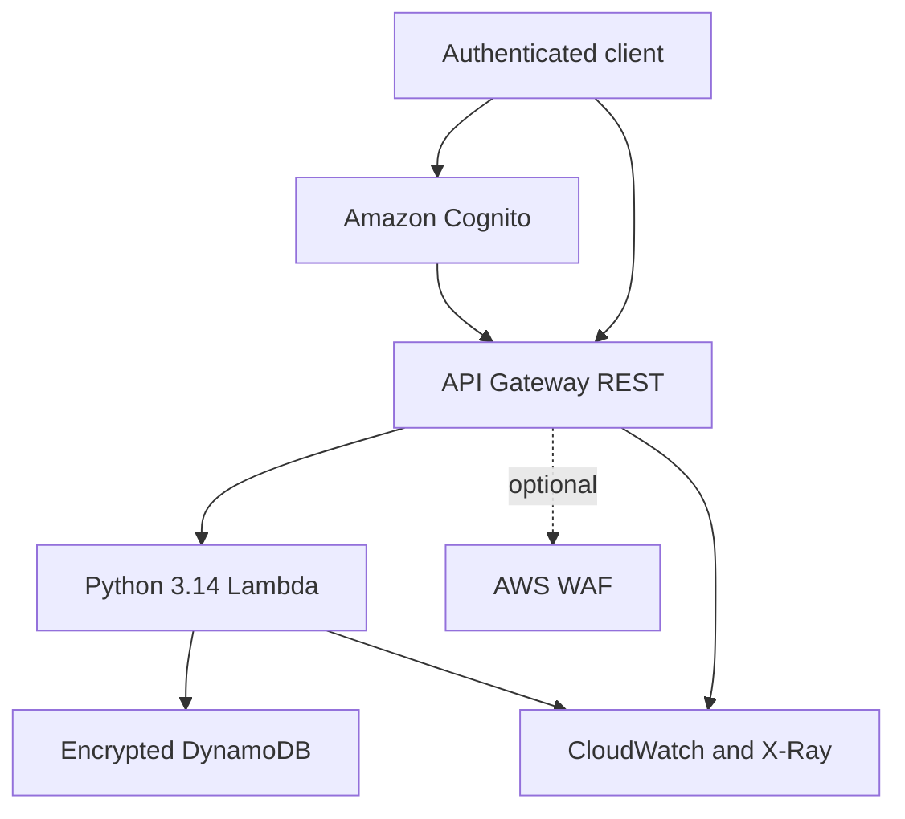

# Secure Serverless API & DevSecOps Lab

A deliberately small AWS security lab that protects license records with per-owner authorization, administrator separation, strict input validation, least-privilege IAM, infrastructure as code, and an automated DevSecOps pipeline.

The project is portfolio-ready but does not claim to be deployed. AWS resources are created only when the manual deployment workflow or Terraform is run with valid credentials.

## What it demonstrates

- Secure serverless API design with AWS Lambda, API Gateway REST, Cognito, and DynamoDB.
- Object-level authorization that blocks BOLA/IDOR access across owners.
- Secure-by-default responses, bounded input, generic errors, and payload-free structured logs.
- Terraform split by responsibility instead of one monolithic file.
- GitHub Actions CI/CD on `ubuntu-latest` with Python 3.14 and Node.js 24.
- SAST, SCA, secret scanning, IaC policy checks, dependency review, and post-deployment DAST.
- GitHub OIDC deployment with short-lived AWS credentials rather than stored access keys.
- Throttling, reserved concurrency, encryption, point-in-time recovery, X-Ray, and CloudWatch alarms.

## Architecture



The API Gateway authorizer validates the Cognito token. The Lambda still performs resource-level authorization because authentication alone does not prevent BOLA/IDOR.

## API surface

| Method     | Path                                | Access                                  |
| ---------- | ----------------------------------- | --------------------------------------- |
| `GET`    | `/health`                         | Public                                  |
| `POST`   | `/licenses`                       | Authenticated; owner defaults to caller |
| `GET`    | `/licenses/{license_id}`          | Owner or administrator                  |
| `POST`   | `/licenses/{license_id}/validate` | Owner or administrator                  |
| `DELETE` | `/licenses/{license_id}`          | Administrator only                      |

The full contract is in [openapi/openapi.json](openapi/openapi.json).

## Install and verify locally on Windows

Prerequisites:

- Python 3.14.
- Node.js 24.
- Terraform 1.15.9.
- AWS CLI v2 only when running the live AWS lab.
- A sandbox AWS identity permitted to create and destroy the declared resources.

From the repository root in PowerShell:

```powershell
py -3.14 -m venv .venv
Set-ExecutionPolicy -Scope Process Bypass
.\.venv\Scripts\Activate.ps1
python -m pip install --upgrade pip
python -m pip install --requirement requirements.txt

python -m compileall -q src tests tools
python -m unittest discover -s tests -v
python tools/security_checks.py
python tools/iac_policy_checks.py
npm run validate:openapi
python tools/package_lambda.py

Set-Location infra
terraform fmt -check -recursive
terraform init -backend=false
terraform validate
Set-Location ..
```

`tools/package_lambda.py --skip-dependencies` creates a source-only ZIP for offline Terraform validation. The normal build includes the pinned AWS SDK.

## Live AWS test with Terraform

> [!WARNING]
> These steps create AWS resources. WAF starts incurring additional charges when enabled. Use a dedicated sandbox account and complete the teardown even when a test fails.

The local workflow uses a local Terraform state file. Do not delete `infra/terraform.tfstate` before the teardown because Terraform needs it to find everything it created.

### 1. Configure AWS access

Use an existing sandbox profile or create an AWS IAM Identity Center profile. Never place access keys in this repository.

```powershell
aws configure sso --profile secure-api-lab
aws sso login --profile secure-api-lab
$env:AWS_PROFILE = "secure-api-lab"
aws sts get-caller-identity
```

The last command must show the intended sandbox account before continuing.

### 2. Prepare the deployment

```powershell
Copy-Item infra\terraform.tfvars.example infra\terraform.tfvars
python tools/package_lambda.py

Set-Location infra
terraform init -reconfigure
terraform fmt -check -recursive
terraform validate
```

Review `terraform.tfvars` and the plan before every apply. WAF remains disabled by default.

### 3. Deploy and test without WAF

```powershell
terraform plan "-out=no-waf.tfplan" "-var-file=terraform.tfvars"
terraform apply no-waf.tfplan

$ApiUrl = terraform output -raw api_base_url
$Health = Invoke-RestMethod -Method Get -Uri "$ApiUrl/health"
$Health

$WafEnabled = terraform output -raw waf_enabled
if ($WafEnabled -ne "false")
{
  throw "WAF must be disabled during the no-WAF test."
}

Push-Location ..
python tools/dast_scan.py --target $ApiUrl
Pop-Location
```

The public live checks validate the health route, security headers, cache policy, and anonymous rejection on a protected route. To include malformed-payload and BOLA checks, also pass test-user tokens through `--user-token`, `--other-user-token`, and `--license-id`. Do not commit tokens or store them in `.tfvars` files.

### 4. Enable WAF and repeat the live test

This updates the same deployment and state instead of creating a second environment.

```powershell
terraform plan -out=with-waf.tfplan -var-file=terraform.tfvars -var="enable_waf=true"
terraform apply with-waf.tfplan

$ApiUrl = terraform output -raw api_base_url
$Region = terraform output -raw aws_region
$StageArn = terraform output -raw api_stage_arn
$ExpectedWafArn = terraform output -raw waf_web_acl_arn
$AssociatedWafArn = aws wafv2 get-web-acl-for-resource --resource-arn $StageArn --region $Region --query "WebACL.ARN" --output text

if ($AssociatedWafArn -ne $ExpectedWafArn)
{
  throw "The expected WAF web ACL is not associated with the API stage."
}

Push-Location ..
python tools/dast_scan.py --target $ApiUrl
Pop-Location
```

The lab verifies the WAF association through the AWS API. It intentionally does not send hundreds of requests to trigger the rate rule because that would turn a functional check into an avoidable load test.

### 5. Destroy every resource created by the local test

Run this from `infra` immediately after testing, including after a partial failure:

```powershell
terraform plan -destroy -out=destroy.tfplan -var-file=terraform.tfvars -var="enable_waf=true"
terraform apply destroy.tfplan

$RemainingResources = terraform state list
if ($RemainingResources)
{
  throw "Terraform still tracks resources. Review the state before closing the lab."
}

Set-Location ..
Remove-Item Env:AWS_PROFILE -ErrorAction SilentlyContinue
```

Do not use manual AWS deletion as the normal teardown path because it can leave Terraform state inconsistent.

## Manual GitHub deploy and emergency teardown

`Deploy AWS` remains manual and uses a protected GitHub Environment plus OIDC credentials. It stores state in the configured S3 backend. `Destroy AWS` is a separate manual workflow that uses the same environment and state key.

To destroy a GitHub-deployed lab:

1. Open **Actions** and select **Destroy AWS**.
2. Select the same environment used by **Deploy AWS**.
3. Enter `destroy` in the confirmation field.
4. Run the workflow and wait for the destruction plan and apply to finish.

The state bucket, GitHub OIDC provider, and deployment role are prerequisites outside this Terraform configuration and are therefore not deleted by the teardown workflow. Read [docs/deployment.md](docs/deployment.md) before creating AWS resources.

## Security documentation

- [Architecture and trust boundaries](docs/architecture.md)
- [Threat model](docs/threat-model.md)
- [Deployment and operations](docs/deployment.md)
- [Vulnerability reporting](SECURITY.md)

## Scope and limitations

This is a focused lab, not a production SaaS platform. It does not include a frontend, mobile application, custom domain, multi-region failover, notification delivery, or a billing system. Cognito deletion protection is disabled so the lab can be destroyed cleanly. The production hardening checklist documents the controls to revisit before real use.

## License

MIT
